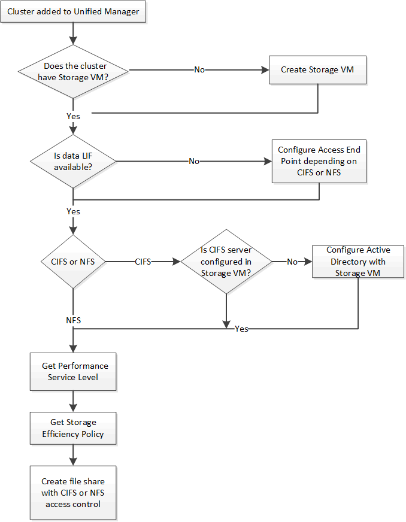

= 使用 Active IQ Unified Manager API 设置 CIFS 和 NFS 文件共享
:allow-uri-read: 
:icons: font
:imagesdir: ../media/

[role="lead"]
您可以使用作为 Active IQ Unified Manager 一部分提供的配置 API，在您的 Storage Virtual Machines (SVM) 上配置 CIFS 共享和 NFS 文件共享。此配置工作流详细介绍了在创建文件共享之前检索 SVM、性能服务级别和存储效率策略的密钥的步骤。

下图说明了文件共享调配工作流中的每个步骤。它包括调配 CIFS 共享和 NFS 文件共享。

[NOTE]
====
确保以下内容：

* ONTAP 集群已添加到 Unified Manager 中，并且已获取集群密钥。
* 已在群集上创建了 SVM。
* SVM 支持 CIFS 和 NFS 服务。如果 SVM 不支持所需的服务，则配置文件共享可能会失败。
* FCP 端口已联机以进行端口配置。

====
. 确定要在其上创建 CIFS 共享的 SVM 上是否有可用的数据 LIF 或访问端点。获取 SVM 上可用访问端点的列表：
+
[cols="3*"]
|===
| 类别 | HTTP 谓词 | 路径 

 a| 
storage-provider
 a| 
GET
 a| 
`/storage-provider/access-endpoints`
`/storage-provider/access-endpoints/\{key}`

|===
+
*示例 cURL*

+
[listing]
----
curl -X GET "https://<hostname>/api/storage-provider/access-endpoints?resource.key=7d5a59b3-953a-11e8-8857-00a098dcc959" -H "accept: application/json" -H "Authorization: Basic <Base64EncodedCredentials>"
----
. 如果您的访问端点在列表中可用，请获取访问端点密钥，否则创建访问端点。
+
[NOTE]
====
请确保创建的访问端点已启用 CIFS 协议。除非您创建了已启用 CIFS 协议的访问端点，否则配置 CIFS 共享将失败。

====
+
[cols="3*"]
|===
| 类别 | HTTP 谓词 | 路径 

 a| 
storage-provider
 a| 
POST
 a| 
`/storage-provider/access-endpoints`

|===
+
*示例 cURL*

+
必须输入要创建的访问端点的详细信息作为输入参数。

+
[listing]
----
curl -X POST "https://<hostname>/api/storage-provider/access-endpoints" -H "accept: application/json" -H "Content-Type: application/json" -H "Authorization: Basic <Base64EncodedCredentials>"
{ \"data_protocols\": \"nfs\",
\"fileshare\": { \"key\": \"cbd1757b-0580-11e8-bd9d-00a098d39e12:type=volume,uuid=f3063d27-2c71-44e5-9a69-a3927c19c8fc\" },
\"gateway\": \"10.132.72.12\",
\"ip\": { \"address\": \"10.162.83.26\",
\"ha_address\": \"10.142.83.26\",
\"netmask\": \"255.255.0.0\" },
\"lun\": { \"key\": \"cbd1757b-0580-11e8-bd9d-00a098d39e12:type=lun,uuid=d208cc7d-80a3-4755-93d4-5db2c38f55a6\" },
\"mtu\": 15000, \"name\": \"aep1\",
\"svm\": { \"key\": \"cbd1757b-0580-11e8-bd9d-00a178d39e12:type=vserver,uuid=1d1c3198-fc57-11e8-99ca-00a098d38e12\" },
\"vlan\": 10}"
----
+
JSON 输出显示一个作业对象键，可用于验证您创建的访问端点。

. 验证访问端点：
+
[cols="3*"]
|===
| 类别 | HTTP 谓词 | 路径 

 a| 
management-server
 a| 
GET
 a| 
`/management-server/jobs/\{key}`

|===
. 确定是必须创建 CIFS 共享还是 NFS 文件共享。要创建 CIFS 共享，请按照以下子步骤操作：
+
.. 确定是否在您的 SVM 上配置了 CIFS 服务器，即确定是否在 SVM 上创建了 Active Directory 映射。
+
[cols="3*"]
|===
| 类别 | HTTP 谓词 | 路径 

 a| 
storage-provider
 a| 
GET
 a| 
`/storage-provider/active-directories-mappings`

|===
.. 如果创建了 Active Directory 映射，请获取密钥，否则在 SVM 上创建 Active Directory 映射。
+
[cols="3*"]
|===
| 类别 | HTTP 谓词 | 路径 

 a| 
storage-provider
 a| 
POST
 a| 
`/storage-provider/active-directories-mappings`

|===
+
*示例 cURL*

+
您必须输入用于创建 Active Directory 映射的详细信息，作为输入参数。

+
[listing]
----
curl -X POST "https://<hostname>/api/storage-provider/active-directories-mappings" -H "accept: application/json" -H "Content-Type: application/json" -H "Authorization: Basic <Base64EncodedCredentials>"
{ \"_links\": {},
\"dns\": \"10.000.000.000\",
\"domain\": \"example.com\",
\"password\": \"string\",
\"svm\": { \"key\": \"9f4ddea-e395-11e9-b660-005056a71be9:type=vserver,uuid=191a554a-f0ce-11e9-b660-005056a71be9\" },
\"username\": \"string\"}"
----
+
这是一个同步调用，您可以在输出中验证 Active Directory 映射的创建。如果发生错误，将显示错误消息，以便您排除故障并重新运行请求。

. 获取要在其上创建 CIFS 共享或 NFS 文件共享的 SVM 的 SVM 密钥，如 _Verifying SVMs on clusters_ 工作流主题中所述。
. 通过运行以下 API 并从响应中检索密钥，获取性能服务级别的密钥。
+
[cols="3*"]
|===
| 类别 | HTTP 谓词 | 路径 

 a| 
storage-provider
 a| 
GET
 a| 
`/storage-provider/performance-service-levels`

|===
+
[NOTE]
====
您可以通过将 `system_defined`输入参数设置为 `true`来检索系统定义的性能服务级别的详细信息。从输出中，获取要应用于文件共享的性能服务级别的键。

====
. （可选）通过运行以下 API 并从响应中检索密钥，获取要应用于文件共享的存储效率策略的存储效率策略密钥。
+
[cols="3*"]
|===
| 类别 | HTTP 谓词 | 路径 

 a| 
storage-provider
 a| 
GET
 a| 
`/storage-provider/storage-efficiency-policies`

|===
. 创建文件共享。您可以通过指定访问控制列表和导出策略来创建同时支持 CIFS 和 NFS 的文件共享。如果您希望创建仅支持卷上其中一种协议的文件共享，以下子步骤提供了相关信息。在创建 NFS 共享后，您还可以更新 NFS 文件共享以包含访问控制列表。有关信息，请参见_修改存储工作负载_主题。
+
.. 如果仅创建 CIFS 共享，请收集有关访问控制列表（ACL）的信息。要创建 CIFS 共享，请为以下输入参数提供有效值。对于您分配的每个用户组，在调配 CIFS/SMB 共享时会创建 ACL。根据您为 ACL 和 Active Directory 映射输入的值，在创建 CIFS 共享时将确定访问控制和映射。
+
*带有示例值的 cURL 命令*

+
[listing]
----
{
  "access_control": {
    "acl": [
      {
        "permission": "read",
        "user_or_group": "everyone"
      }
    ],
    "active_directory_mapping": {
      "key": "3b648c1b-d965-03b7-20da-61b791a6263c"
    },
----
.. 对于仅创建 NFS 文件共享，请收集与导出策略相关的信息。要创建 NFS 文件共享，请为以下输入参数提供有效值。根据您的值，导出策略在创建时与 NFS 文件共享相关联。
+
[NOTE]
====
在配置 NFS 共享时，可以通过提供所有必需值来创建导出策略，也可以提供导出策略密钥并重用现有导出策略。如果要重用存储 VM 的导出策略，则需要添加导出策略密钥。除非您知道密钥，否则可以使用 `/datacenter/protocols/nfs/export-policies` API 检索导出策略密钥。要创建新策略，必须输入以下示例中显示的规则。对于输入的规则，API 尝试通过匹配主机、存储 VM 和规则来搜索现有导出策略。如果存在现有导出策略，则使用该策略。否则，将创建一个新的导出策略。

====
+
*带有示例值的 cURL 命令*

+
[listing]
----
"export_policy": {
      "key": "7d5a59b3-953a-11e8-8857-00a098dcc959:type=export_policy,uuid=1460288880641",
      "name_tag": "ExportPolicyNameTag",
      "rules": [
        {
          "clients": [
            {
              "match": "0.0.0.0/0"
            }
----

+
配置访问控制列表和导出策略后，为 CIFS 和 NFS 文件共享的强制输入参数提供有效值：

[NOTE]
====
存储效率策略是用于创建文件共享的可选参数。

====
[cols="3*"]
|===
| 类别 | HTTP 谓词 | 路径 

 a| 
storage-provider
 a| 
POST
 a| 
`/storage-provider/file-shares`

|===
JSON 输出显示一个作业对象键，您可以使用它来验证您创建的文件共享。使用查询作业时返回的作业对象键来验证文件共享的创建：

[cols="3*"]
|===
| 类别 | HTTP 谓词 | 路径 

 a| 
management-server
 a| 
GET
 a| 
`/management-server/jobs/\{key}`

|===
在响应末尾，您会看到创建的文件共享的密钥。

[listing]
----

    ],
    "job_results": [
        {
            "name": "fileshareKey",
            "value": "7d5a59b3-953a-11e8-8857-00a098dcc959:type=volume,uuid=e581c23a-1037-11ea-ac5a-00a098dcc6b6"
        }
    ],
    "_links": {
        "self": {
            "href": "/api/management-server/jobs/06a6148bf9e862df:-2611856e:16e8d47e722:-7f87"
        }
    }
}
----
. 通过使用返回的密钥运行以下 API 来验证文件共享的创建：
+
[cols="3*"]
|===
| 类别 | HTTP 谓词 | 路径 

 a| 
storage-provider
 a| 
GET
 a| 
`/storage-provider/file-shares/\{key}`

|===
+
*JSON 输出示例*

+
可以看到， `/storage-provider/file-shares` 的 POST 方法在内部调用每个功能所需的所有 API 并创建对象。例如，它调用  `/storage-provider/performance-service-levels/` API 在文件共享上分配性能服务级别。

+
[listing]
----
{
    "key": "7d5a59b3-953a-11e8-8857-00a098dcc959:type=volume,uuid=e581c23a-1037-11ea-ac5a-00a098dcc6b6",
    "name": "FileShare_377",
    "cluster": {
        "uuid": "7d5a59b3-953a-11e8-8857-00a098dcc959",
        "key": "7d5a59b3-953a-11e8-8857-00a098dcc959:type=cluster,uuid=7d5a59b3-953a-11e8-8857-00a098dcc959",
        "name": "AFFA300-206-68-70-72-74",
        "_links": {
            "self": {
                "href": "/api/datacenter/cluster/clusters/7d5a59b3-953a-11e8-8857-00a098dcc959:type=cluster,uuid=7d5a59b3-953a-11e8-8857-00a098dcc959"
            }
        }
    },
    "svm": {
        "uuid": "b106d7b1-51e9-11e9-8857-00a098dcc959",
        "key": "7d5a59b3-953a-11e8-8857-00a098dcc959:type=vserver,uuid=b106d7b1-51e9-11e9-8857-00a098dcc959",
        "name": "RRT_ritu_vs1",
        "_links": {
            "self": {
                "href": "/api/datacenter/svm/svms/7d5a59b3-953a-11e8-8857-00a098dcc959:type=vserver,uuid=b106d7b1-51e9-11e9-8857-00a098dcc959"
            }
        }
    },
    "assigned_performance_service_level": {
        "key": "1251e51b-069f-11ea-980d-fa163e82bbf2",
        "name": "Value",
        "peak_iops": 75,
        "expected_iops": 75,
        "_links": {
            "self": {
                "href": "/api/storage-provider/performance-service-levels/1251e51b-069f-11ea-980d-fa163e82bbf2"
            }
        }
    },
    "recommended_performance_service_level": {
        "key": null,
        "name": "Idle",
        "peak_iops": null,
        "expected_iops": null,
        "_links": {}
    },
    "space": {
        "size": 104857600
    },
    "assigned_storage_efficiency_policy": {
        "key": null,
        "name": "Unassigned",
        "_links": {}
    },
    "access_control": {
        "acl": [
            {
                "user_or_group": "everyone",
                "permission": "read"
            }
        ],
        "export_policy": {
            "id": 1460288880641,
            "key": "7d5a59b3-953a-11e8-8857-00a098dcc959:type=export_policy,uuid=1460288880641",
            "name": "default",
            "rules": [
                {
                    "anonymous_user": "65534",
                    "clients": [
                        {
                            "match": "0.0.0.0/0"
                        }
                    ],
                    "index": 1,
                    "protocols": [
                        "nfs3",
                        "nfs4"
                    ],
                    "ro_rule": [
                        "sys"
                    ],
                    "rw_rule": [
                        "sys"
                    ],
                    "superuser": [
                        "none"
                    ]
                },
                {
                    "anonymous_user": "65534",
                    "clients": [
                        {
                            "match": "0.0.0.0/0"
                        }
                    ],
                    "index": 2,
                    "protocols": [
                        "cifs"
                    ],
                    "ro_rule": [
                        "ntlm"
                    ],
                    "rw_rule": [
                        "ntlm"
                    ],
                    "superuser": [
                        "none"
                    ]
                }
            ],
            "_links": {
                "self": {
                    "href": "/api/datacenter/protocols/nfs/export-policies/7d5a59b3-953a-11e8-8857-00a098dcc959:type=export_policy,uuid=1460288880641"
                }
            }
        }
    },
    "_links": {
        "self": {
            "href": "/api/storage-provider/file-shares/7d5a59b3-953a-11e8-8857-00a098dcc959:type=volume,uuid=e581c23a-1037-11ea-ac5a-00a098dcc6b6"
        }
    }
}
----

