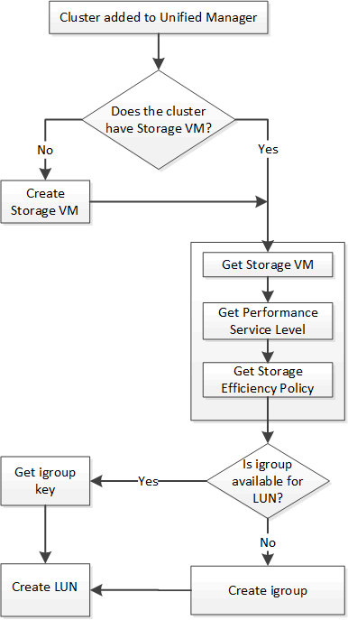

= 使用 Active IQ Unified Manager API 配置 LUN
:allow-uri-read: 
:icons: font
:imagesdir: ../media/

[role="lead"]
您可以使用作为 Active IQ Unified Manager 一部分提供的资源调配 API 在 Storage Virtual Machine (SVM) 上配置 LUN。此资源调配工作流详细介绍了在创建 LUN 之前检索 SVM、性能服务级别和存储效率策略的密钥的步骤。

下图说明了 LUN 配置工作流中的步骤。

[NOTE]
====
此工作流假定 ONTAP 集群已添加到 Unified Manager 中，并且已获取集群密钥。此工作流还假定已在集群上创建了 SVM。

====
. 获取要在其上创建 LUN 的 SVM 的 SVM 密钥，如 _Verifying SVMs on clusters_ 工作流主题中所述。
. 通过运行以下 API 并从响应中检索密钥，获取性能服务级别的密钥。
+
[cols="3*"]
|===
| 类别 | HTTP 谓词 | 路径 

 a| 
storage-provider
 a| 
GET
 a| 
`/storage-provider/performance-service-levels`

|===
+
[NOTE]
====
您可以通过将 `system_defined`输入参数设置为 `true`来检索系统定义的性能服务级别的详细信息。从输出中，获取要在 LUN 上应用的性能服务级别的键。

====
. （可选）通过运行以下 API 并从响应中检索密钥，获取要应用于 LUN 的存储效率策略的存储效率策略密钥。
+
[cols="3*"]
|===
| 类别 | HTTP 谓词 | 路径 

 a| 
storage-provider
 a| 
GET
 a| 
`/storage-provider/storage-efficiency-policies`

|===
. 确定是否已创建启动器组（igroup）以授予对要创建的 LUN 目标的访问权限。
+
[cols="3*"]
|===
| 类别 | HTTP 谓词 | 路径 

 a| 
数据中心
 a| 
GET
 a| 
`/datacenter/protocols/san/igroups`  `/datacenter/protocols/san/igroups/\{key}`

|===
+
您必须输入用于指示 igroup 具有授权访问权限的 SVM 的参数值。此外，如果要查询特定的 igroup，请输入 igroup 名称（键）作为输入参数。

. 在输出中，如果可以找到要授予访问权限的 igroup，请获取密钥。否则，请创建 igroup。
+
[cols="3*"]
|===
| 类别 | HTTP 谓词 | 路径 

 a| 
数据中心
 a| 
POST
 a| 
`/datacenter/protocols/san/igroups`

|===
+
必须输入要创建的 igroup 的详细信息作为输入参数。这是一个同步调用，您可以在输出中验证创建的 igroup。如果发生错误，将显示一条消息，供您进行故障排除并重新运行 API。

. 创建 LUN。
+
[cols="3*"]
|===
| 类别 | HTTP 谓词 | 路径 

 a| 
storage-provider
 a| 
POST
 a| 
`/storage-provider/luns`

|===
+
要创建 LUN，请确保已将检索到的值添加为必需输入参数。

+
[NOTE]
====
存储效率策略是用于创建 LUN 的可选参数。

====
+
*示例 cURL*

+
您必须输入要创建的 LUN 的所有详细信息作为输入参数。

+
JSON 输出将显示可用于验证您创建的 LUN 的作业对象键。

. 使用在查询作业时返回的作业对象键来验证 LUN 创建：
+
[cols="3*"]
|===
| 类别 | HTTP 谓词 | 路径 

 a| 
management-server
 a| 
GET
 a| 
`/management-server/jobs/\{key}`

|===
+
在响应的末尾，您将看到创建的 LUN 的键。

. 使用返回的密钥运行以下 API，以验证 LUN 的创建：
+
[cols="3*"]
|===
| 类别 | HTTP 谓词 | 路径 

 a| 
storage-provider
 a| 
GET
 a| 
`/storage-provider/luns/\{key}`

|===
+
*JSON 输出示例*

+
可以看到， `/storage-provider/luns` 的 POST 方法在内部调用每个函数所需的所有 API 并创建对象。例如，它调用用于在 LUN 上分配性能服务级别的  `/storage-provider/performance-service-levels/` API。

+
== LUN 创建或映射失败的故障排除步骤

完成此工作流后，您可能仍会看到 LUN 创建失败。即使成功创建了 LUN，由于在创建 LUN 的节点上 SAN LIF 或访问端点不可用，与 igroup 的 LUN 映射也可能会失败。如果发生故障，您可以看到以下消息：

[listing]
----
The nodes <node_name> and <partner_node_name> have no LIFs configured with the iSCSI or FCP protocol for Vserver <server_name>. Use the access-endpoints API to create a LIF for the LUN.
----
按照这些疑难解答步骤来解决此失败问题。

. 在尝试创建 LUN 的 SVM 上创建支持 ISCSI/FCP 协议的访问端点。
+
[cols="3*"]
|===
| 类别 | HTTP 谓词 | 路径 

 a| 
storage-provider
 a| 
POST
 a| 
`/storage-provider/access-endpoints`

|===
+
*示例 cURL*

+
必须输入要创建的访问端点的详细信息作为输入参数。

+
[NOTE]
====
确保在输入参数中添加了用于指示 LUN 主节点的地址和用于指示主节点配对节点的 ha_address。运行此操作时，它会在主节点和配对节点上创建访问端点。

====
. 使用 JSON 输出中返回的作业对象键查询作业，以验证其已成功运行并在 SVM 上添加了访问端点，并且已在 SVM 上启用了 iSCSI/FCP 服务。
+
[cols="3*"]
|===
| 类别 | HTTP 谓词 | 路径 

 a| 
management-server
 a| 
GET
 a| 
`/management-server/jobs/\{key}`

|===
+
*JSON 输出示例*

+
在输出结束时，您可以看到创建的访问端点的密钥。在下面的输出中，"name": "accessEndpointKey" 值表示在 LUN 的主节点上创建的访问端点，其密钥为 9c964258-14ef-11ea-95e2-00a098e32c28。"name": "accessEndpointHAKey" 值表示在主节点的配对节点上创建的访问端点，其密钥为 9d347006-14ef-11ea-8760-00a098e3215f。

. 修改 LUN 以更新 igroup 映射。有关工作流修改的详细信息，请参见 "`修改存储工作负载`"。
+
[cols="3*"]
|===
| 类别 | HTTP 谓词 | 路径 

 a| 
storage-provider
 a| 
PATCH
 a| 
`/storage-provider/lun/\{key}`

|===
+
在输入中，指定要用于更新 LUN 映射的 igroup 密钥，以及 LUN 密钥。

+
*示例 cURL*

+
JSON 输出将显示一个作业对象键，可用于验证映射是否成功。

. 通过使用 LUN 密钥进行查询来验证 LUN 映射。
+
[cols="3*"]
|===
| 类别 | HTTP 谓词 | 路径 

 a| 
storage-provider
 a| 
GET
 a| 
`/storage-provider/luns/\{key}`

|===
+
*JSON 输出示例*

+
在输出中，您可以看到 LUN 已成功映射到最初为其配置的 igroup（键 d19ec2fa-fec7-11e8-b23d-00a098e32c28）。

