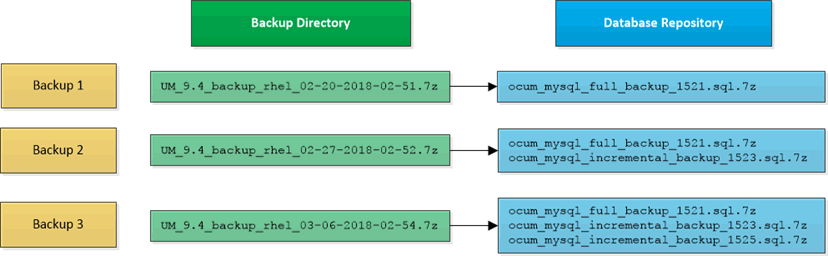

= 使用 Active IQ Unified Manager 中的 MySQL 数据库转储进行备份和还原
:allow-uri-read: 
:icons: font
:imagesdir: ../media/

[role="lead"]
MySQL 数据库转储备份是 Active IQ Unified Manager 数据库和配置文件的副本，可在系统故障或数据丢失时使用。您可以安排将备份写入本地目标或远程目标。强烈建议您定义 Active IQ Unified Manager 主机系统外部的远程位置。

[NOTE]
====
当在 Linux 和 Windows 服务器上安装 Unified Manager 时，MySQL 数据库转储是默认的备份机制。但是，如果 Unified Manager 管理大量集群和节点，或者您的 MySQL 备份需要花费数小时才能完成，则可以使用 Snapshot 副本进行备份。此功能在 Red Hat Enterprise Linux 和 Windows 上可用。

====
数据库转储备份由备份目录中的单个文件和数据库存储库目录中的一个或多个文件组成。备份目录中的文件非常小，因为它只包含指向数据库存储库目录中重新创建备份所需的文件的指针。

首次生成数据库备份时，会在备份目录中创建一个文件，并在数据库存储库目录中创建一个完整备份文件。下次生成备份时，将在备份目录中创建一个文件，并在数据库存储库目录中创建一个增量备份文件，其中包含与完整备份文件的差异。随着您创建更多备份，此过程将继续进行，直到达到最大保留设置，如下图所示。

[NOTE]
====
请勿重命名或删除这两个目录中的任何备份文件，否则后续的还原操作将会失败。

====
如果您将备份文件写入本地系统，则应启动一个进程将备份文件复制到远程位置，以便能够在出现需要完整还原的系统问题时使用这些文件。

在开始备份操作之前，Active IQ Unified Manager 会执行完整性检查，以验证所有必需的备份文件和备份目录是否存在且可写。它还会检查系统上是否有足够的空间来创建备份文件。
