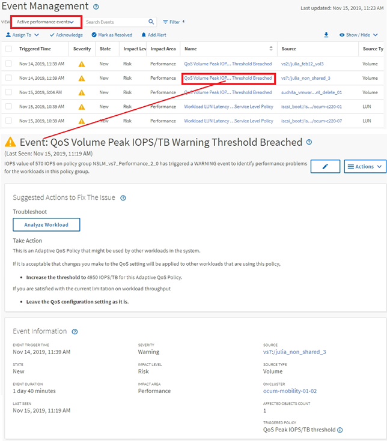

= 调查 Active IQ Unified Manager 中的性能事件
:allow-uri-read: 
:icons: font
:imagesdir: ../media/

[role="lead"]
Unified Manager 事件详细信息页面可让您深入了解任何性能事件。这在调查性能事件、进行故障排除以及微调系统性能时非常有用。

根据性能事件的类型，您可能会看到两种类型的事件详细信息页面之一：

* 用户定义和系统定义的阈值策略事件的事件详细信息页面
* 动态阈值策略事件的事件详细信息页面

这是事件调查导航的一个示例。

. 在左侧导航窗格中，单击*事件管理*。
. 在“视图”菜单中，单击 *Active performance events*。
. 单击要调查的事件名称，系统将显示事件详情页面。
. 查看事件的描述并查看建议操作（如有），查看可帮助您解决问题的事件的更多详细信息。您可以单击*分析工作负载*按钮，显示详细的性能图表，以帮助进一步分析问题。

