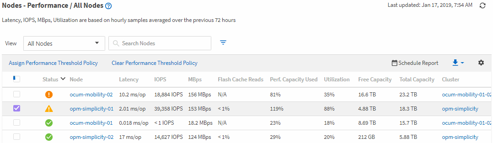

= 使用 Active IQ Unified Manager 中的性能清单页面监控对象性能
:allow-uri-read: 
:icons: font
:imagesdir: ../media/

[role="lead"]
对象清单性能页面显示对象类型类别中所有对象的性能信息、性能事件和对象健康状况。这使您可以一目了然地了解集群中每个对象的性能状态，例如，所有节点或所有卷的性能状态。

对象清单性能页面提供对象状态的高级概述，使您能够评估所有对象的整体性能并比较对象性能数据。您可以通过搜索、排序和筛选来细化对象清单页面的内容。这在监控和管理对象性能时很有用，因为它使您能够快速定位存在性能问题的对象并开始故障排除过程。

默认情况下，性能清单页面上的对象会根据对象性能关键程度进行排序。首先列出具有新的关键性能事件的对象，其次列出具有警告事件的对象。这为必须解决的问题提供了即时的可视化指示。所有性能数据均基于 72 小时的平均值。

您可以通过单击对象名称列中的对象名称，轻松地从对象清单性能页面导航至对象详细信息页面。例如，在 Performance/All Nodes 清单页面上，您可以单击 *Nodes* 列中的节点对象。对象详细信息页面提供有关所选对象的深入信息和详细内容，包括活动事件的并排比较。
