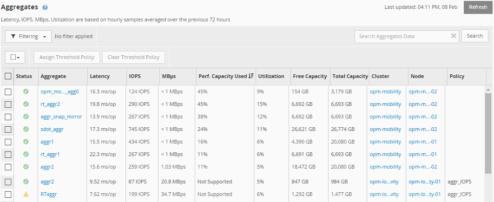

= 在 Active IQ Unified Manager 中查看节点和聚合性能容量使用值
:allow-uri-read: 
:icons: font
:imagesdir: ../media/

[role="lead"]
您可以监视集群中所有节点或所有聚合的性能容量使用值，也可以查看单个节点或聚合的详细信息。

“使用的性能容量”值显示在“仪表板”、“性能清单”页面、“最高性能对象”页面、“创建阈值策略”页面、“性能资源管理器”页面和详细信息图表中。例如，“性能：所有聚合”页面提供了一个“使用的性能容量”列，用于查看所有聚合的使用的性能容量值。

监控使用的性能容量计数器使您能够识别以下内容：

* 任何集群上的任何节点或聚合是否具有较高的已用性能容量值
* 是否任何集群上的任何节点或聚合具有活动的性能容量使用事件
* 集群中具有最高和最低性能容量已用值的节点和聚合
* 与具有高性能容量使用值的节点或聚合结合使用的延迟和利用率计数器值
* 如果其中一个节点发生故障，HA 对中节点的性能容量使用值将如何受到影响
* 具有高性能容量使用值的聚合上最繁忙的卷和 LUN

