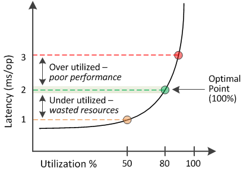

= 使用 Active IQ Unified Manager 中的已用性能容量值
:allow-uri-read: 
:icons: font
:imagesdir: ../media/

[role="lead"]
此性能容量已用值可帮助您识别当前被过度利用或未充分利用的节点和聚合。这使您能够重新分配工作负载，以提高存储资源的效率。

下图显示了资源的延迟与利用率曲线，并使用彩色点标识了当前操作点可能位于的三个区域。

* 性能容量使用百分比等于 100 处于最佳点。
+
目前，资源正在得到有效利用。

* 使用的性能容量百分比高于 100 表示节点或聚合过度使用，并且工作负载正在接收次优性能。
+
不应向资源中添加新工作负载，并且可能需要重新分配现有工作负载。

* 使用的性能容量百分比低于 100 表示节点或聚合未充分利用，并且资源未得到有效利用。
+
可以向资源中添加更多工作负载。

[NOTE]
====
与利用率不同，性能容量使用百分比可以高于 100%。没有最高百分比，但资源在过度使用时通常在 110% 至 140% 的范围内。百分比越高，表示资源存在严重问题。

====