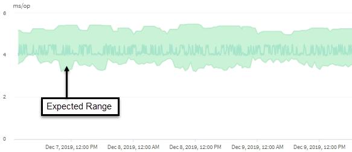

= 使用 Active IQ Unified Manager 中的延迟预测进行性能分析
:allow-uri-read: 
:icons: font
:imagesdir: ../media/

[role="lead"]
Unified Manager 使用延迟预测来表示受监控工作负载的典型 I/O 延迟（响应时间）活动。当工作负载的实际延迟高于延迟预测的上限时，它会向您发出警报，从而触发动态性能事件，以便您可以分析性能问题并采取纠正措施来解决该问题。

延迟预测设置工作负载的性能基线。随着时间的推移，Unified Manager 会从过去的性能测量中学习，以预测工作负载的预期性能和活动水平。预期范围的上边界建立动态性能阈值。Unified Manager 使用基线来确定实际延迟何时高于或低于阈值，或超出其预期范围的界限。实际值和预期值之间的比较为工作负载创建了性能配置文件。

当工作负载的实际延迟超过动态性能阈值时，由于集群组件上的争用，延迟会很高，并且工作负载的运行速度会比预期的慢。共享相同集群组件的其他工作负载的性能也可能比预期的慢。

Unified Manager 会分析阈值跨越事件，并确定该活动是否为性能事件。如果高工作负载活动在很长一段时间内保持一致，例如几个小时，Unified Manager 会认为该活动正常，并动态调整延迟预测以形成新的动态性能阈值。

某些工作负载可能一直处于低活动状态，其延迟预测随时间推移的变化率不高。为了在分析性能事件期间最大限度地减少事件数量，Unified Manager 仅针对操作和延迟远高于预期的低活动卷触发事件。

在此示例中，卷的延迟预测（以灰色表示）最低为 3.5 毫秒/次操作（ms/op），最高为 5.5 ms/op。如果由于网络流量的间歇性激增或集群组件上的争用，实际延迟（以蓝色表示）突然增加到 10 ms/op，则它将高于延迟预测，并超过动态性能阈值。

当网络流量减少或集群组件不再处于竞争状态时，延迟将返回到延迟预测范围内。如果延迟长时间保持在 10 ms/op 或以上，则可能需要采取纠正措施来解决此事件。
