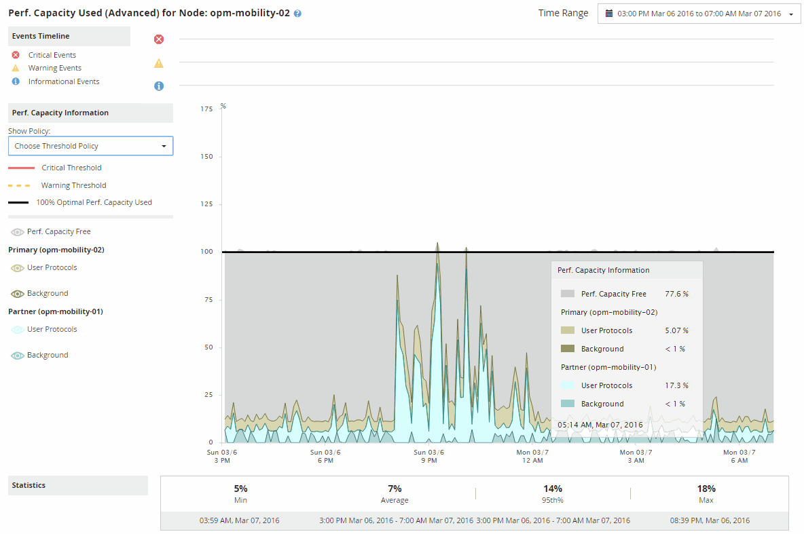

= 在 Active IQ Unified Manager 中使用已用性能容量明细图表进行故障转移规划
:allow-uri-read: 
:icons: font
:imagesdir: ../media/

[role="lead"]
详细的已用性能容量 - 细分图表显示了主节点和配对节点所使用的性能容量。它还显示了预估接管节点上的可用性能容量。此信息可帮助您确定如果配对节点出现故障，是否可能会出现性能问题。

除了显示节点使用的总性能容量外，细分图还将每个节点的值分解为用户协议和后台进程。

* 用户协议是用户应用程序与集群之间的 I/O 操作。
* 后台进程是涉及存储效率、数据复制和系统运行状况的内部系统进程。

这种额外的详细信息级别使您能够确定性能问题是由用户应用程序活动还是后台系统进程引起的，例如重复数据删除、RAID 重建、磁盘清理和 SnapMirror 副本。

.步骤
. 转到将用作 Estimated Takeover 节点的 *Performance/Node Failover Planning* 页面。
. 从*时间范围*选择器中，选择在计数器网格和计数器图表中显示历史统计信息的时间段。
+
此时将显示包含主节点、伙伴节点和预计接管节点统计信息的计数器图表。

. 从*选择图表*列表中，选择*性能已用容量*。
. 在*已用性能容量*图表中，选择*明细*，然后单击*缩放视图*。
+
此时将显示 Perf.Capacity Used 的详细图表。

+

. 将光标移到详细图表上，以在弹出窗口中查看已用性能容量信息。
+
Perf.Capacity Free 百分比是估计接管节点上可用的性能容量。它指示故障转移后接管节点上剩余的性能容量。如果为 0%，故障转移将导致接管节点上的延迟增加到不可接受的水平。

. 考虑采取纠正措施，以避免性能容量空闲百分比过低。
+
如果您计划为节点维护启动故障转移，请选择在性能容量空闲百分比不为 0 时使配对节点发生故障的时间。

