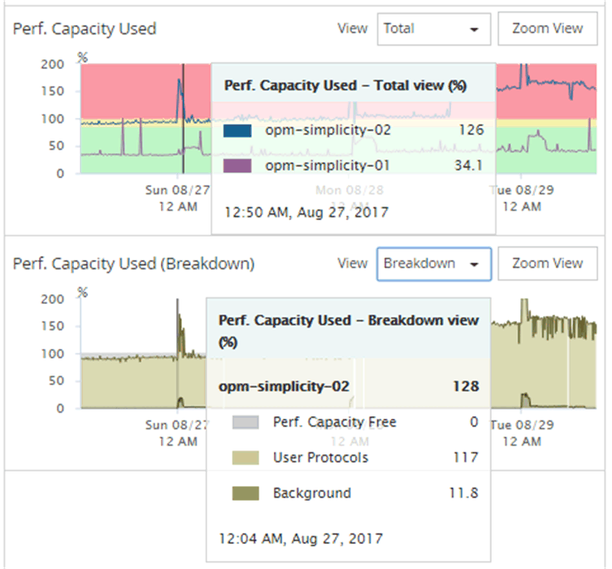

= 在 Active IQ Unified Manager 中查看性能容量计数器图表
:allow-uri-read: 
:icons: font
:imagesdir: ../media/

[role="lead"]
您可以在“性能资源管理器”页面上查看节点和聚合的性能容量使用图表。这使您能够查看特定时间范围内选定节点和聚合的详细性能容量数据。

标准计数器图表显示选定节点或聚合的性能容量已用值。细分计数器图表显示根对象的总性能容量值，并按用户协议与后台系统进程的使用情况进行细分。此外，还显示空闲性能容量。

[NOTE]
====
由于与系统和数据管理相关的一些后台活动被标识为用户工作负载并归类为用户协议，因此当这些进程运行时，用户协议百分比可能会显得人为偏高。这些进程通常在集群使用率较低的午夜左右运行。如果您在午夜左右看到用户协议活动激增，请验证集群备份作业或其他后台活动是否配置为在该时间运行。

====
.步骤
. 从节点或聚合*着陆*页面中选择*资源管理器*选项卡。
. 在 *Counter Charts* 窗格中，单击 *Choose charts*，然后选择 *Perf.Capacity Used* 图表。
. 向下滚动，直到您可以查看图表。
+
标准图表的颜色显示对象何时处于最佳范围（黄色）、对象何时未充分利用（绿色）以及对象何时过度利用（红色）。细分图表仅显示根对象的详细性能容量详细信息。

+

. 如果要以全尺寸格式查看任一图表，请单击*缩放视图*。
+
通过这种方式，您可以在单独的窗口中打开多个计数器图表，以比较相同时间范围内的性能容量使用值与 IOPS 或 MBps 值。

