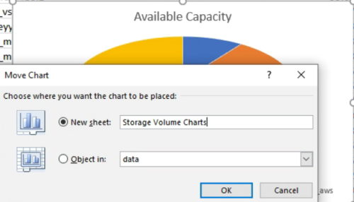

= 创建报告以查看 Active IQ Unified Manager 中的可用卷容量图表
:allow-uri-read: 
:icons: font
:imagesdir: ../media/

[role="lead"]
您可以创建报告以分析 Excel 图表中的可用卷容量。

.开始之前
* 您必须具有应用程序管理员或存储管理员角色。

使用以下步骤打开运行状况：所有卷视图，在 Excel 中下载视图，创建可用容量图表，上传自定义的 Excel 文件，并计划最终报告。

.步骤
. 在左侧导航窗格中，单击 *Storage* > *Volumes*。
. 选择 *报告* > *下载 Excel*。
+
image::../media/download_excel_menu.png[显示如何从报告中下载 Excel 的 UI 屏幕截图。]

+
根据您的浏览器，您可能需要单击*确定*以保存文件。

. 如果需要，请单击*启用编辑*。
. 在 Excel 中，打开下载的文件。
. 在 `data`工作表上，选择要在 `Volume`和 `Available Data` % 列中使用的数据。
. 在 *Insert* 菜单中，选择一个 `3-D piechart.`
+
该图表显示哪些卷的可用空间最大。该图表显示在数据表上。

+
[NOTE]
====
根据您的网络配置，选择整列或过多的数据行可能会使饼图难以阅读。此示例使用三维饼图，但您可以使用任何图表类型。使用最能显示要捕获的数据的图表。

====
. 将图表标题命名为 *可用容量*。
. 右键单击图表并选择*移动图表*。
. 选择*新工作表*并将该工作表命名为*存储卷图表*。
+
[NOTE]
====
确保新工作表显示在信息和数据表之后。

====
+

. 使用*设计*和*格式*菜单（在选择图表时可用），您可以自定义图表的外观。
. 满意后，保存包含更改的文件。
. 在 Unified Manager 中，选择 *报告* > *上传 Excel*。
+
[NOTE]
====
确保您位于下载 Excel 文件的相同视图下。

====
. 选择已修改的 Excel 文件。
. 单击*打开*。
. 单击*提交*。
+
*报告* > *上传 Excel* 菜单项旁边会出现一个复选标记。

+
image::../media/upload_excel.png[显示如何将 excel 上传到报表的 UI 屏幕截图。]

. 单击*已计划报告*。
. 单击*添加计划*可将新行添加到*报告计划*页面，以便您可以定义新报告的计划特性。
. 输入报告计划的名称并填写其他报告字段，然后单击该行末尾的复选标记（image:../media/blue_check.gif[""]）。
+
[NOTE]
====
为报告选择 *XLSX* 格式。

====
+
此时将立即发送一个测试报告。之后，此报告将以指定频率生成并通过电子邮件发送给列出的收件人。

根据报告显示的结果，您可能需要平衡卷上的负载。
