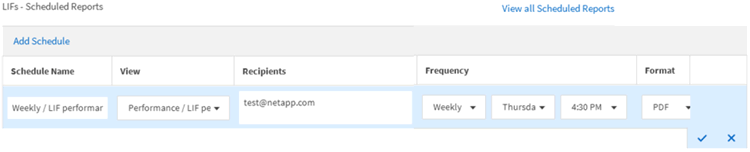

= 在 Active IQ Unified Manager 中计划报告
:allow-uri-read: 
:icons: font
:imagesdir: ../media/

[role="lead"]
在您拥有要计划定期生成和分发的视图或 Excel 文件后，您可以计划该报表。

.开始之前
* 您必须具有应用程序管理员或存储管理员角色。
* 您必须在 *常规* > *通知* 页面中配置 SMTP 服务器设置，以便报告引擎可以将报告作为电子邮件附件从 Unified Manager 服务器发送到收件人列表。
* 必须将电子邮件服务器配置为允许使用生成的电子邮件发送附件。

使用以下步骤来测试和计划要为视图生成的报告。选择或自定义要使用的视图。以下过程使用显示网络接口性能的网络视图，但您可以使用任何所需的视图。

.步骤
. 打开视图。此示例使用显示 LIF 性能的默认网络视图。在左侧导航窗格中，单击 *网络 > 网络接口*。
. 使用内置的 Unified Manager 功能根据需要自定义视图。
. 自定义视图后，您可以在 *视图* 字段中提供一个唯一的名称，然后单击复选标记进行保存。
+
image::../media/view_save.gif[显示如何保存视图的 UI 屏幕截图。]

. 您可以使用 Microsoft® Excel 的高级功能自定义报表。有关详细信息，请参见 link:task_use_excel_to_customize_your_report.html["使用 Excel 自定义报告"]。
. 要在计划或共享输出之前查看输出，请执行以下操作：
+
[cols="2*"]
|===
| 选项 | 问题描述 

 a| 
*如果使用 Excel 自定义报告*
 a| 
查看现有下载的 Excel 文件。

 a| 
*如果您没有使用 Excel 自定义报告*
 a| 
将报告下载为 *CSV*、*PDF* 或 *XLSX* 文件。

|===
+
使用已安装的应用程序（例如 Microsoft Excel (CSV/XSLX) 或 Adobe Acrobat (PDF)）打开文件。

. 如果对报告感到满意，请单击*计划报告*。
. 在“报告计划”页面中，单击 *添加计划*。
. 接受默认名称，这是视图名称和频率的组合，或自定义*计划名称*。
. 要首次测试计划报告，请仅将您自己添加为*收件人*。满意后，添加所有报告收件人的电子邮件地址。
. 指定生成报告并发送给收件人的频率。您可以选择*每日*、*每周*或*每月*。
. 选择格式，可以是 *PDF*、*CSV* 或 *XSLX*。
+
[NOTE]
====
对于使用 Excel 自定义内容的报告，请始终选择 *XSLX*。

====
. 单击复选标记（image:../media/blue_check.gif[""]）以保存报告计划。
+

+
报告会立即作为测试发送。之后，报告将生成，并按计划的频率通过电子邮件发送给列出的收件人。

