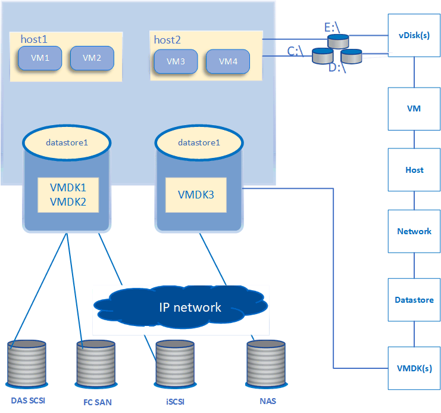

= 了解 Active IQ Unified Manager 如何监控 VMware 虚拟基础架构
:allow-uri-read: 
:icons: font
:imagesdir: ../media/

[role="lead"]
Active IQ Unified Manager 提供了对虚拟基础架构中虚拟机（VM）的可见性，并支持对虚拟环境中的存储和性能问题进行监控和故障排除。您可以使用此功能来确定存储环境中的任何延迟问题，或者 vCenter 服务器上是否存在报告的性能事件。

ONTAP 上的典型虚拟基础架构部署具有分布在计算、网络和存储层中的各种组件。VM 应用程序中的任何性能滞后都可能是由于各个层中各种组件所面临的延迟组合而发生的。此功能对存储和 vCenter Server 管理员以及 IT 通才非常有用，他们需要分析虚拟环境中的性能问题并了解问题发生在哪个组件中。

您现在可以从 VMware 部分的 vCenter 菜单访问 vCenter Server。列出的每个虚拟机的 peek 视图在 TOPOLOGY VIEW 中具有 *VCENTER SERVER* 链接，该链接可在新浏览器中启动 vCenter Server。您还可以使用 *展开拓扑* 按钮启动 vCenter Server，然后单击 *在 vCenter 中查看* 按钮以查看 vCenter Server 中的数据存储。

Unified Manager 以拓扑视图呈现虚拟环境的基础子系统，以确定计算节点、网络或存储中是否出现延迟问题。该视图还突出显示了导致性能滞后的特定对象，以便采取补救措施并解决根本问题。

部署在 ONTAP 存储上的虚拟基础架构包括以下对象：

* vCenter 服务器：用于管理虚拟环境中的 VMware 虚拟机、ESXi 主机和所有相关组件的集中式控制平面。有关 vCenter 服务器的详细信息，请参见 VMware 文档。
* 主机：运行 ESXi（VMware 提供的虚拟化软件）并托管虚拟机的物理或虚拟系统。
* 数据存储：数据存储是连接到 ESXi 主机的虚拟存储对象。数据存储是 ONTAP 的可管理存储实体，例如 LUN 或卷，用作 VM 文件的存储库，例如日志文件、脚本、配置文件和虚拟磁盘。它们通过 SAN 或 IP 网络连接连接到环境中的主机。映射到 vCenter Server 的 ONTAP 外部的数据存储不受支持，也不会在 Unified Manager 中显示。
* 虚拟机：VMware 虚拟机。
* 虚拟磁盘：属于具有 VMDK 扩展名的虚拟机的数据存储上的虚拟磁盘。来自虚拟磁盘的数据存储在相应的 VMDK 上。
* VMDK：数据存储库上为虚拟磁盘提供存储空间的虚拟机磁盘。每个虚拟磁盘都有一个相应的 VMDK。

上述对象会呈现为一个虚拟机拓扑视图。

*基于 ONTAP 的 VMware 虚拟化*

*用户工作流*

下图显示了使用虚拟机拓扑视图的一个典型用例：

image::../media/vm_workflow.gif[显示跨计算、网络和存储层定位虚拟机应用程序延迟的工作流的图表]

[[what-is-not-supported]]
== 不支持的内容

* Unified Manager 不支持位于 ONTAP 外部且映射到 vCenter Server 实例的数据存储。同样也不支持在这些数据存储上具有虚拟磁盘的任何虚拟机。
* 不支持跨多个 LUN 的数据存储。
* 不支持使用网络地址转换（NAT）来映射数据 LIF（访问端点）的数据存储。
* 不支持在多 LIF 配置中具有相同 IP 地址的不同集群上将卷或 LUN 导出为数据存储，因为 Unified Manager 无法识别哪个数据存储属于哪个集群。
+
示例：假设集群 A 具有数据存储 A。数据存储 A 通过具有相同 IP 地址 x.x.x.x 的数据 LIF 导出，并在此数据存储上创建虚拟机 A。同样，集群 B 具有数据存储 B。数据存储 B 通过具有相同 IP 地址 x.x.x.x 的数据 LIF 导出，并在数据存储 B 上创建虚拟机 B。UM 将无法将虚拟机 A 拓扑的数据存储 A 映射到相应的 ONTAP 卷/LUN，也无法映射虚拟机 B。

* 仅支持 NAS 和 SAN 卷（VMFS 的 iSCSI 和 FCP）作为数据存储，不支持虚拟卷（vVols）。
* 仅支持 iSCSI 虚拟磁盘。不支持 NVMe 和 SATA 类型的虚拟磁盘。
* 视图不允许生成用于分析各种组件性能的报告。
* 对于仅支持 Unified Manager 上的虚拟基础架构的存储虚拟机（storage VM）灾难恢复（DR）设置，必须在 vCenter Server 中手动更改配置，以便在切换和回切方案中指向活动 LUN。如果没有人工干预，其数据存储将无法访问。

