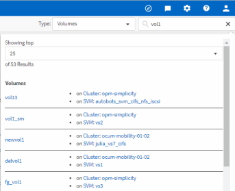

= 在 Active IQ Unified Manager 中搜索存储对象
:allow-uri-read: 
:icons: font
:imagesdir: ../media/

[role="lead"]
您可以使用菜单栏顶端的*搜索所有存储对象*字段快速访问特定对象。这种对所有对象进行全局搜索的方法使您能够按类型快速定位特定对象。搜索结果按存储对象类型排序，您可以使用下拉菜单按对象进一步筛选它们。

.开始之前
* 必须具有以下角色之一才能执行此任务：操作员、应用程序管理员或存储管理员。
* 有效的搜索必须至少包含三个字符。

使用下拉菜单值“全部”时，全局搜索将显示在所有对象类别中找到的结果总数；每个对象类别最多可有 25 个搜索结果。您可以从下拉菜单中选择特定对象类型，以优化特定对象类型内的搜索。在这种情况下，返回的列表不限于前 25 个对象。

可以搜索的对象类型包括：

* 集群
* 节点
* Storage VM
* 聚合
* 卷
* qtree
* SMB 共享
* NFS 共享
* 用户或组配额
* LUN 数
* NVMe 命名空间
* 启动程序组
* 启动程序
* 一致性组

输入工作负载名称将返回相应的卷或 LUN 类别下的工作负载列表。

您可以单击搜索结果中的任何对象以导航到该对象的“运行状况”详细信息页面。如果没有对象的直接运行状况页面，则会显示父对象的运行状况页面。例如，在搜索特定 LUN 时，将显示 LUN 所在的 SVM 详细信息页面。

[NOTE]
====
端口和 LIF 在全局搜索栏中不可搜索。

====
.步骤
. 从菜单中选择对象类型，以仅针对单一对象类型细化搜索结果。
. 在 *Search all Storage Objects* 字段中输入对象名称的至少三个字符。
+
在此示例中，下拉框选择了 Volumes 对象类型。在 *搜索所有存储对象* 字段中键入 "vol1" 将显示名称包含这些字符的所有卷的列表。

+

